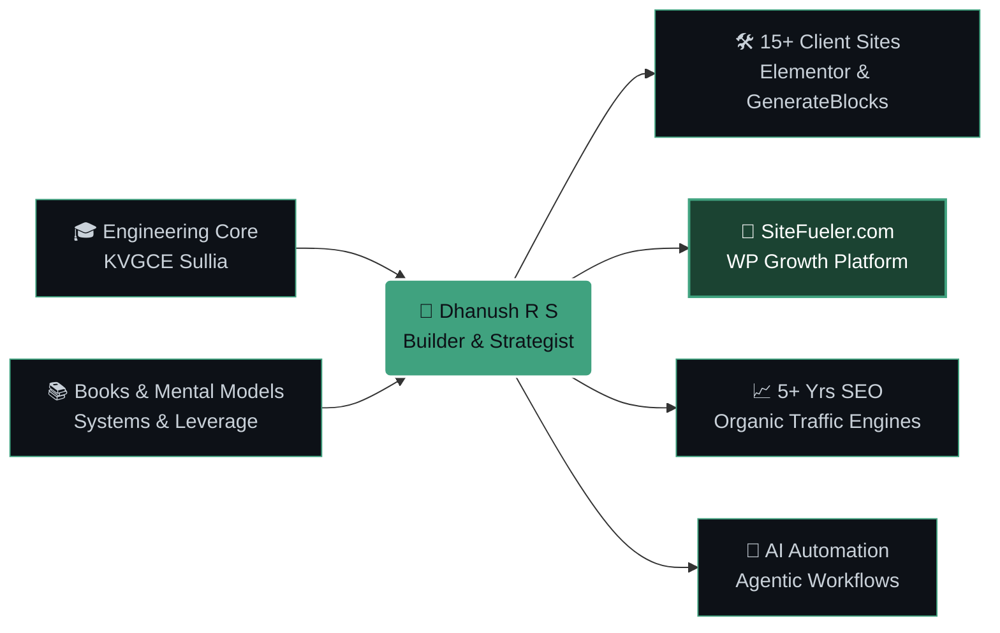
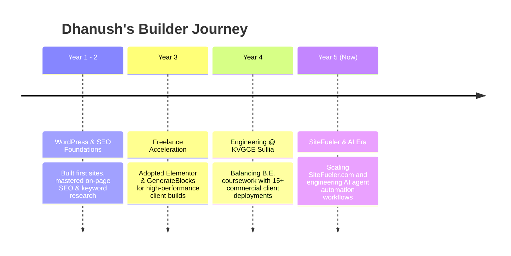

<div align="center">

<!-- ======================== 1. CINEMATIC SCI-FI HEADER ======================== -->


<!-- Multi-Track Live Terminal Ticker -->
<a href="https://git.io/typing-svg">
  
</a>

<!-- Visual Status HUD -->
<p align="center">
  
  
  
  
</p>

<!-- Quick Action Portal & Live Counters -->
<p align="center">
  <a href="https://sitefueler.com/"></a>&nbsp;
  <a href="https://www.linkedin.com/in/rsdhanush/"></a>&nbsp;
  <a href="mailto:dhanushrs013@gmail.com"></a>&nbsp;
  <a href="https://github.com/dhanushrs1?tab=repositories"></a>&nbsp;
  &nbsp;
  
</p>

</div>

<!-- Animated Neon Matrix Line -->


<!-- ======================== 2. VISUAL CHARACTER SHEET & DAILY CLOCK ======================== -->
### 🧬 `01 // VISUAL CHARACTER HUD & DAILY TELEMETRY`

<table>
<tr>
<td width="50%" valign="top">

<h4 align="center">⚡ SKILL PROFICIENCY & XP BARS</h4>

```text
WORDPRESS & ELEMENTOR   ███████████████████░ 95%
GENERATEBLOCKS / UI     ██████████████████░░ 90%
TECHNICAL & ON-PAGE SEO ██████████████████░░ 92%
FRONTEND (HTML/CSS/JS)  ████████████████░░░░ 85%
REACT / NEXT.JS / NODE  ██████████████░░░░░░ 75%
AI AGENTS & AUTOMATION  ████████████████░░░░ 80%
```

```yaml
developer_profile:
  name: "Dhanush R S"
  college: "KVG College of Engineering, Sullia (VTU)"
  experience: "5+ Years (WordPress & SEO)"
  flagship_build: "SiteFueler.com"
  current_focus: "AI Agents & Growth Systems"
```

<p align="center">
  
  
  
</p>

</td>
<td width="50%" valign="top">

<h4 align="center">⏱️ 24-HOUR SYSTEM ALLOCATION</h4>

```diff
+ [DAILY EXECUTION LOOP]
+ 07:00 ━━━┳━━━ 13:30  🎓 B.E. Engineering @ KVGCE
+          ┃           [Lectures, Labs, Core CS]
! 14:00 ━━━╋━━━ 18:30  🚀 SiteFueler & Client Builds
!          ┃           [Elementor, GenerateBlocks, SEO]
+ 19:00 ━━━╋━━━ 21:00  📚 Books, Mindset & Recharge
+          ┃           [Deep Reading & Strategy]
- 21:30 ━━━┻━━━ 01:00  🤖 R&D: AI Agents & Workflows

- [BOTTLENECKS ELIMINATED]
- Bloated themes, slow DOMs & manual repetitive tasks
```

<p align="center">
  
  
</p>

</td>
</tr>
</table>

<br/>

<!-- ======================== 3. VISUAL ARCHITECTURE MAP ======================== -->
### 🗺️ `02 // THE ECOSYSTEM BLUEPRINT (HOW MY WORLD CONNECTS)`

<div align="center">



</div>

<br/>

<!-- ======================== 4. THE VISUAL BOOKSHELF & MINDSET ======================== -->
### 📚 `03 // THE MINDSET & BOOKSHELF (MENTAL OPERATING SYSTEM)`
> *Code builds the product; books build the architect. Here are the core books and philosophies powering my daily execution:*

<table>
<tr>
<td width="25%" align="center" valign="top">
  <br/>
  <b>Atomic Habits</b><br/>
  <sub><i>James Clear</i></sub><br/><br/>
  <br/>
  <sub><b>Core Takeaway:</b> Systems over goals. How I balance morning engineering lectures with shipping SiteFueler at night.</sub>
</td>
<td width="25%" align="center" valign="top">
  <br/>
  <b>Deep Work</b><br/>
  <sub><i>Cal Newport</i></sub><br/><br/>
  <br/>
  <sub><b>Core Takeaway:</b> Ruthless, distraction-free focus blocks to ship 15+ client sites end-to-end without burnout.</sub>
</td>
<td width="25%" align="center" valign="top">
  <br/>
  <b>Zero to One</b><br/>
  <sub><i>Peter Thiel</i></sub><br/><br/>
  <br/>
  <sub><b>Core Takeaway:</b> Don't just do client work—build a proprietary product ecosystem (<a href="https://sitefueler.com/">SiteFueler.com</a>).</sub>
</td>
<td width="25%" align="center" valign="top">
  <br/>
  <b>The Almanack</b><br/>
  <sub><i>Naval Ravikant</i></sub><br/><br/>
  <br/>
  <sub><b>Core Takeaway:</b> Combining code, SEO content, and autonomous AI agents as permissionless leverage.</sub>
</td>
</tr>
</table>

<br/>

<!-- ======================== 5. VISUAL PROJECT SHOWCASE ======================== -->
### 🚀 `04 // COMMAND DECK: ACTIVE MODULES & OPERATIONS`

<table>
<tr>
<td width="33%" align="center" valign="top">
  
  <h3>🟢 MODULE 01<br/>SiteFueler Platform</h3>
  
  <p align="left">
    • 📦 <b>Ready-to-Ship Templates</b><br/>
    • 🧩 <b>Code Snippets</b> & micro-tools<br/>
    • ⚡ Growth hub for <b>WP Builders</b>
  </p>
  <a href="https://sitefueler.com/">
    
  </a>
</td>

<td width="33%" align="center" valign="top">
  
  <h3>🟢 MODULE 02<br/>WordPress Studio</h3>
  
  <p align="left">
    • 🎨 <b>Elementor</b> & <b>GenerateBlocks</b><br/>
    • 🚀 <b>95+ Core Web Vitals</b> speed<br/>
    • 🛠️ Custom End-to-End Builds
  </p>
  <a href="mailto:dhanushrs013@gmail.com">
    
  </a>
</td>

<td width="33%" align="center" valign="top">
  
  <h3>🟢 MODULE 03<br/>SEO & AI Workflows</h3>
  
  <p align="left">
    • 🔍 <b>Semantic</b> Keyword Clustering<br/>
    • 📈 Organic Content Architecture<br/>
    • 🤖 <b>AI Agent</b> Automation R&D
  </p>
  <a href="https://www.linkedin.com/in/rsdhanush/">
    
  </a>
</td>
</tr>
</table>

<!-- Interactive Click-to-Open Visual Vaults -->
<details>
<summary><b>📂 [CLICK TO UNLOCK] // Visual Journey Timeline (5-Year Evolution)</b></summary>
<br/>


</details>

<details>
<summary><b>🧪 [CLICK TO UNLOCK] // After-Hours R&D Lab (AI Agents & Automation)</b></summary>
<br/>

> **What I'm currently building behind the scenes:**
> - 🤖 **Autonomous SEO & Content Agents:** Designing multi-step LLM workflows that research, structure, and optimize technical content automatically.
> - 🔗 **Headless & Hybrid Architectures:** Bridging React/Next.js frontends and Python automation scripts with WordPress REST APIs.
> - ⚡ **Creator Micro-Utilities:** Shipping lightweight workflow boosters directly into **[SiteFueler.com](https://sitefueler.com/)**.
</details>

<br/>

<!-- Animated Neon Matrix Line -->


<!-- ======================== 6. VISUAL TECH MATRIX ======================== -->
### 🎛️ `05 // FULL-STACK TECH INVENTORY`

<div align="center">

<table>
<tr>
<td align="center" width="25%"><b>🌐 Frontend & UI</b></td>
<td align="center" width="25%"><b>⚙️ Backend & Core</b></td>
<td align="center" width="25%"><b>📦 CMS & Builders</b></td>
<td align="center" width="25%"><b>🛠️ DevOps & Design</b></td>
</tr>
<tr>
<td align="center">
  
</td>
<td align="center">
  
</td>
<td align="center">
  <br/><br/>
  
  
</td>
<td align="center">
  
</td>
</tr>
</table>

</div>

<br/>

<!-- ======================== 7. LIVE TELEMETRY & TROPHY CABINET ======================== -->
### 🏆 `06 // LIVE GITHUB TELEMETRY & CONTRIBUTION RADAR`

<div align="center">

<!-- Trophy Rack -->


<br/><br/>

<!-- Stats + Streak Side-by-Side -->


<br/><br/>

<!-- Glowing Area Contribution Radar -->


<br/><br/>

<!-- Classic Emerald Green Contribution Grid -->


</div>

<br/>

<!-- ======================== 8. FOOTER PORTAL ======================== -->
<div align="center">

```diff
+ ============================================================================== +
| 💬 SYSTEM READY: Open to talking WordPress, SEO, Books, AI Agents, or          |
|    whatever SiteFueler needs next. Let's connect and build something great!    |
+ ============================================================================== +
```

<a href="https://sitefueler.com/">
  
</a>&nbsp;&nbsp;
<a href="mailto:dhanushrs013@gmail.com">
  
</a>


</div>
